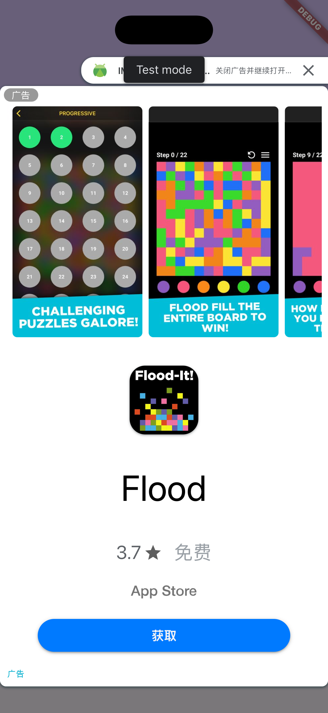
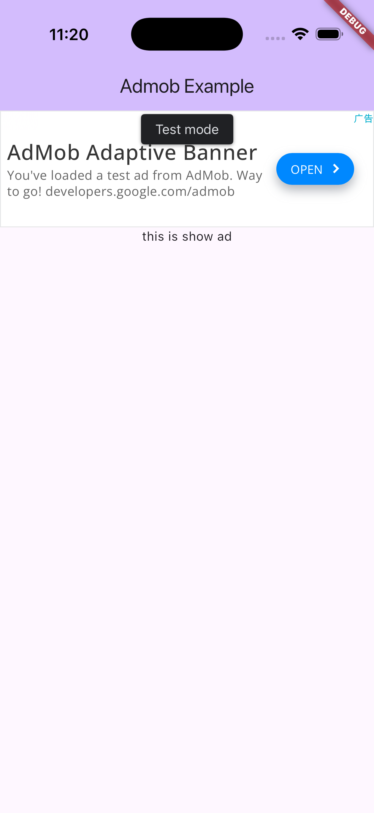

[](https://pub.dev/packages/sint_admob)
[](https://lunagao.github.io/BlessYourCodeTag/)

AdMob banner and app open ads for Flutter apps using [Sint](https://pub.dev/packages/sint). Supports Android and iOS.

## Features

- Adaptive banner ads with standard and large size policies.
- On-demand banner loading or startup preloading.
- Per-widget caching by ad unit and width, with automatic disposal.
- Bounded retries with 2, 4, and 8 second backoff delays.
- Optional app open ads with expiration handling and lifecycle integration.
- Structured app open diagnostics without an analytics dependency.
- Test ad units and ad enablement controlled by Dart build flags.

| App open ad | Banner ad |
| --- | --- |
|  |  |

## Requirements

- Flutter 3.47.0 or later.
- Dart 3.13.0 or later.
- An AdMob account and registered Android or iOS app.
- The platform requirements of [`google_mobile_ads`](https://pub.dev/packages/google_mobile_ads).

Ad loading is supported only on Android and iOS. Initialization is a no-op on other platforms.

## Installation

Add the package and the dependencies used by the examples to your `pubspec.yaml`:

```yaml
dependencies:
  sint_admob: ^0.0.1
  sint: ^2.3.0
  material_ui: ^1.11.1
```

Then run:

```bash
flutter pub get
```

`material_ui` is needed only when using the standalone Material widgets shown below.

## Platform setup

Follow the [AdMob Flutter quick start](https://developers.google.com/admob/flutter/quick-start) to register your app and configure its AdMob application ID. The IDs below are Google's test application IDs; replace them with your production IDs when releasing your app.

### iOS

Add `GADApplicationIdentifier` to `ios/Runner/Info.plist`:

```xml
<key>GADApplicationIdentifier</key>
<string>ca-app-pub-3940256099942544~1458002511</string>
```

### Android

Add the application metadata inside `<application>` in `android/app/src/main/AndroidManifest.xml`:

```xml
<meta-data
    android:name="com.google.android.gms.ads.APPLICATION_ID"
    android:value="ca-app-pub-3940256099942544~3347511713"/>
```

## Usage

### 1. Register ad units

Create `app_ad_units.dart`. These are Google's test banner units; use your own units for production builds.

```dart
import 'package:sint_admob/sint_admob.dart';

class AppAdUnits {
  static final homeBanner = AdmobUnitId(
    androidUnitId: 'ca-app-pub-3940256099942544/9214589741',
    iosUnitId: 'ca-app-pub-3940256099942544/2435281174',
  );

  static final detailBanner = AdmobUnitId(
    androidUnitId: 'ca-app-pub-3940256099942544/9214589741',
    iosUnitId: 'ca-app-pub-3940256099942544/2435281174',
  );

  static final adUnits = [homeBanner, detailBanner];
}
```

### 2. Initialize the service

Initialize and register `AdmobService` before `runApp`. The app open ad unit is optional; omit it to disable app open ads.

```dart
import 'package:example/app_ad_units.dart';
import 'package:material_ui/material_ui.dart';
import 'package:sint/sint.dart';
import 'package:sint_admob/sint_admob.dart';

Future<void> main() async {
  WidgetsFlutterBinding.ensureInitialized();

  await Sint.putAsync(
    () => AdmobService().init(
      adUnitIds: AppAdUnits.adUnits,
      appOpenAdUnitId: AdmobUnitId(
        androidUnitId: 'YOUR_ANDROID_APP_OPEN_AD_UNIT_ID',
        iosUnitId: 'YOUR_IOS_APP_OPEN_AD_UNIT_ID',
      ),
      bannerSizePolicy: AdmobBannerSizePolicy.standardAdaptive,
      onDiagnostic: (event) => debugPrint(event.toString()),
    ),
  );

  runApp(const MyApp());
}
```

To disable app open ads:

```dart
await Sint.putAsync(
  () => AdmobService().init(adUnitIds: AppAdUnits.adUnits),
);
```

### 3. Add the lifecycle and loading wrapper

Place `AdaptiveAdLoader` around your app's router content. It loads registered banners when preloading is enabled and shows an available app open ad when the app resumes.

```dart
import 'package:material_ui/material_ui.dart';
import 'package:sint/sint.dart';
import 'package:sint_admob/sint_admob.dart';

class MyApp extends StatelessWidget {
  const MyApp({super.key});

  @override
  Widget build(BuildContext context) {
    return SintApp(
      design: SintDesign.material,
      initialRoute: '/',
      sintPages: [
        SintPage(name: '/', page: () => const HomePage()),
        SintPage(name: '/detail', page: () => const DetailPage()),
      ],
      builder: (context, child) {
        return AdaptiveAdLoader(
          preloadAllBanners: false,
          child: child,
        );
      },
    );
  }
}
```

### 4. Display a banner

Add `AppBannerAd` wherever a banner should appear:

```dart
import 'package:example/app_ad_units.dart';
import 'package:material_ui/material_ui.dart';
import 'package:sint_admob/sint_admob.dart';

class HomePage extends StatelessWidget {
  const HomePage({super.key});

  @override
  Widget build(BuildContext context) {
    return Scaffold(
      appBar: AppBar(title: const Text('AdMob example')),
      body: Column(
        children: [
          AppBannerAd(AppAdUnits.homeBanner),
          const Expanded(child: Center(child: Text('Page content'))),
        ],
      ),
    );
  }
}
```

The widget reserves space only after its banner has loaded.

## Banner loading

`preloadAllBanners` defaults to `false`. In this mode, each `AppBannerAd` loads its banner when mounted and owns a separate `BannerAd`, which is disposed with the widget. Cache entries are scoped by widget instance, ad unit, and width, so rebuilds and width changes do not mount the same `AdWidget` twice.

Set `preloadAllBanners: true` to load every registered banner at startup and whenever the available width changes.

A failed load is retried after 2, 4, and 8 seconds, for at most three retries. Timers and ads are released when their owner or the service is disposed.

For manual loading, the service also exposes:

```dart
final adService = Sint.find<AdmobService>();

await adService.ensureBannerLoaded(AppAdUnits.homeBanner, width);
await adService.loadAllAds(width);
```

## Banner size policies

The default is `AdmobBannerSizePolicy.largeAdaptive`. Select the standard adaptive policy during initialization if it better fits your layout:

```dart
AdmobService().init(
  adUnitIds: AppAdUnits.adUnits,
  bannerSizePolicy: AdmobBannerSizePolicy.standardAdaptive,
);
```

Compare layout, impressions, match rate, and eCPM before changing the policy in a production app.

## App open diagnostics

Pass `onDiagnostic` to `AdmobService.init` to receive `AdmobDiagnosticEvent` objects for load, availability, expiration, show, failure, and dismiss events. Events include the ad unit, timestamp, relevant duration, and AdMob error details when available.

The service also exposes `isAppOpenAdLoading`, `isAppOpenAdAvailable`, `isAppOpenAdShowing`, and `appOpenLoadTime`. No analytics dependency is added.

## Build flags

| Flag | Default | Behavior |
| --- | --- | --- |
| `ENABLE_AD` | `true` | Set to `false` to disable all ad initialization and display. |
| `DEBUG_AD` | `false` | Set to `true` to use Google's test ad units instead of configured production units. |

Run with test ads:

```bash
flutter run --dart-define=DEBUG_AD=true
```

Run with ads disabled:

```bash
flutter run --dart-define=ENABLE_AD=false
```

Production ad units are used by default. Always validate your app with test ads before using production units.

## Example

The included example demonstrates on-demand banners, app open ads, diagnostics, and test ad units:

```bash
cd example
flutter pub get
flutter run --dart-define=DEBUG_AD=true
```

## Contributing

Issues and pull requests are welcome on [GitHub](https://github.com/LunaGao/sint_admob).

## License

BSD 2-Clause. See [LICENSE](https://github.com/LunaGao/sint_admob/blob/main/LICENSE).
